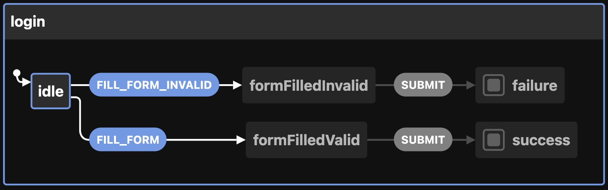

# Model-Based Testing with Playwright

Instead of writing each test by hand, describe how the app behaves as a state machine and let the tests be generated from it. This repo shows the idea on a login form, using [XState](https://xstate.js.org/) for the model and [Playwright](https://playwright.dev/) to drive the browser.

## Why model-based testing

Hand-written tests cover the paths someone thought of. A model covers every path through the states you defined: add a state or transition, and the new paths get tested automatically. A final coverage check fails if any state is never reached, so gaps show up as failures, not as silence.

## How it works

**1. The app** — `index.html` is a login form. Valid credentials show "Welcome!", anything else shows "Invalid credentials."

**2. The model** — `loginMachine.ts` describes the form as a state machine:



| State | Reached by |
| --- | --- |
| `idle` | page load |
| `formFilledValid` | `FILL_FORM` with valid credentials |
| `formFilledInvalid` | `FILL_FORM_INVALID` with wrong credentials |
| `success` | `SUBMIT` from `formFilledValid` |
| `failure` | `SUBMIT` from `formFilledInvalid` |

Each state also says how to *check* it in the browser, for example that the welcome message is visible in `success`.

**3. The tests** — `login.spec.ts` links each model event to a Playwright action (fill the form, click **Login**), then asks `@xstate/test` for the shortest path to every state. Each path becomes its own Playwright test, and a last test calls `testCoverage()` to confirm every state was visited.

## Run it

Requires Node.js.

```bash
git clone https://github.com/nora-weisser/model_based_testing_with_playwright.git
cd model_based_testing_with_playwright
npm install
npx playwright install
```

Serve the app on port 3000 in one terminal:

```bash
npx http-server -p 3000
```

Run the generated tests in another:

```bash
npx playwright test
```

## Tech stack

TypeScript · Playwright · XState · @xstate/test

## Read more

- [Model-Based Testing with Playwright](https://noraweisser.com/2025/10/27/model-based-testing-with-playwright/) — the blog post this repo accompanies
